# Inbound Container Volume Forecasting (GCP MLOps)

End-to-end data engineering and MLOps pipeline on Google Cloud Platform (BigQuery, Dataform, Dataproc Serverless Spark, and Vertex AI) to forecast **daily inbound container volumes per distribution center (DC)** across a 14-day planning horizon.

Built to replace reactive dock and yard scheduling with daily probabilistic container arrival forecasts, enabling proactive dock door allocation, lower yard congestion, and reduced container detention/demurrage costs.

> **Disclaimer:** This repository is a sanitized portfolio reference architecture modeled on enterprise omni-channel retail supply chain workflows. All schemas, table names, and sample datasets generated by `mlops/scripts/` are synthetic and contain no proprietary Walmart data or internal code.

---

## Architecture

```mermaid
flowchart LR
  subgraph S1["1. Data Engineering (Dataform + Spark)"]
    L[(Logistics & EDI 856 ASN)] --> SP[Cloud Spark: EDI ASN Flattening]
    I[(Inventory Snapshots)] --> DF
    L --> DF[Dataform Orchestration]
    SP --> BQRAW[(BigQuery Raw)]
    BQRAW --> DF
    DF --> MART[(Feature Mart<br/>marts.mart_container_volume_features)]
  end

  subgraph S2["2. Training & Governance (Vertex AI)"]
    MART --> V[Validate Features] --> FE[Snapshot & Feature Prep] --> TR[Train & Tune Model]
    FE --> FS[(Vertex AI Feature Store)]
    TR --> GATE{Champion / Challenger Gate}
    GATE -->|Approved| REG[(Vertex AI Model Registry)]
  end

  subgraph S3["3. Batch Inference & Monitoring (Vertex AI)"]
    REG --> PULL[Load @champion] --> INF[Batch Score 14-Day Horizon] --> GEN[Write Forecasts]
    MART --> INF
    GEN --> FC[(BigQuery: ml.container_volume_forecasts)]
    INF --> MON[PSI Drift & Live WAPE Check]
    MON -->|Threshold Breach| ALERT[Cloud Monitoring Alert]
  end

  subgraph S4["4. Downstream Consumption"]
    FC --> VW[serving.vw_dock_planning] --> BI[Planner Dashboards]
  end
```



Detailed component responsibilities, leakage boundaries, and operational procedures are documented in [`docs/architecture.md`](docs/architecture.md) and [`docs/runbook.md`](docs/runbook.md).

---

## Repository Structure

```text
inbound-container-forecasting/
├── dataform/                         # BigQuery SQLX transformations, assertions & schedules
│   ├── definitions/
│   │   ├── sources/                  # Raw table declarations (ASN, dock, inventory, forecasts)
│   │   ├── staging/                  # Deduplication, type casting, ID normalization
│   │   ├── intermediate/             # Daily DC actual arrival & expected ASN aggregations
│   │   ├── marts/                    # Leakage-safe feature mart (history + 14-day future spine)
│   │   └── serving/                  # Dock capacity dimensions, planning & accuracy views
│   ├── includes/constants.js         # Shared schema/horizon constants
│   └── workflow_settings.yaml        # Dataform 3.0 configuration and horizon variables
├── spark/
│   └── jobs/parse_edi_asn.py         # PySpark job (Dataproc Serverless) to flatten nested EDI 856 ASNs
├── mlops/
│   ├── src/inbound_forecast/         # Core Python package (features, train, evaluate, predict, monitoring)
│   ├── pipelines/                    # KFP v2 training/inference DAGs, components, and CLI runner
│   ├── scripts/                      # End-to-end local demo and synthetic BigQuery data loader
│   ├── Dockerfile                    # Runtime container image for Vertex AI pipeline steps
│   └── pyproject.toml                # Package dependencies and build configuration
├── infra/terraform/                  # GCP infrastructure (BigQuery, GCS, IAM, WIF, Dataform, Feature Store, Alerts)
├── sql/ddl_forecasts.sql             # Partitioned/clustered BigQuery DDL for forecast & monitoring tables
├── tests/
│   ├── unit/                         # Unit tests for Spark, Dataform static graph, features, training, KFP compile
│   └── contract/                     # CI contract check validating Dataform mart columns match model features
├── .github/
│   ├── workflows/                    # ci.yml, cd.yml, run-pipeline.yml, terraform-plan.yml
│   └── pull_request_template.md
├── docs/                             # Architecture reference and on-call runbook
├── Makefile                          # Local install, lint, test, compile, demo, and Docker targets
└── ruff.toml                         # Linter and formatter rules
```

---

## Core Engineering & Modeling Decisions

1. **Direct 14-Day Multi-Horizon Forecasting (No Recursive Error Compounding)**
   `mart_container_volume_features` generates a daily spine per DC extending `CURRENT_DATE() + 14`. Every rolling window and lag feature is shifted by at least 14 days (`forecast_horizon_days`), ensuring features available at forecast time *t* for target date *t + 14* match between training and daily batch inference without recursive predictions.
2. **SQL-First Feature Engineering with CI Schema Contracts**
   Feature definitions live in version-controlled Dataform SQLX models (`dataform/definitions/marts/`) guarded by Dataform assertions (`uniqueKey`, `nonNull`, `rowConditions`). During CI, `tests/contract/check_feature_contract.py` compiles the Dataform graph and fails the build if any required feature column in `inbound_forecast` is missing or renamed.
3. **Hybrid Spark + BigQuery Ingestion**
   Nested EDI 856 Advance Ship Notices (shipment -> container -> line item hierarchies) are parsed and flattened using PySpark on Dataproc Serverless (`spark/jobs/parse_edi_asn.py`), while relational joins, window aggregations, and serving views run natively in BigQuery via Dataform.
4. **Count-Aware Gradient Boosting & Uncertainty Intervals**
   A global Poisson-loss gradient boosted model (`dc_id` encoded as a categorical feature) shares statistical strength across distribution centers. Validation residuals calibrate upper-bound prediction intervals, surfacing a `congestion_risk` flag in `serving.vw_dock_planning` when upper-bound arrivals exceed DC dock door capacity.
5. **Champion / Challenger Promotion & Automated Drift Monitoring**
   Candidate models are evaluated against the active `@champion` model on the identical hold-out window using Weighted Absolute Percentage Error (`WAPE`). Promotion requires both beating/matching the champion within `MAX_WAPE_REGRESSION` (`0.02`) and passing `MAX_WAPE_ABSOLUTE` (`0.35`). Every inference run computes Population Stability Index (`PSI`) across numeric features and logs 28-day live WAPE to `ml.model_monitoring`, triggering Cloud Monitoring alerts on threshold breaches.

---

## Local Verification & Demo (No GCP Required)

Run the full test suite and an offline end-to-end simulation (synthetic data generation -> feature engineering -> model training -> batch scoring -> PSI drift check):

```bash
python -m venv .venv && source .venv/bin/activate
make install
make lint
make test
make local-demo
```

---

## GCP Deployment Guide

### 1. Provision Infrastructure (Terraform)

```bash
cd infra/terraform
cp example.tfvars terraform.tfvars
# Update project_id, github_repository, dataform_git_url, dataform_git_secret_version, and alert_email

terraform init -backend-config="bucket=<YOUR_TF_STATE_BUCKET>"
terraform apply -var-file=terraform.tfvars
```

### 2. Initialize Raw Data & Dataform

```bash
# Optional: populate BigQuery raw tables with synthetic logistics/inventory data
python mlops/scripts/load_sample_data.py --project "$PROJECT_ID"
```

Trigger an initial Dataform workflow execution (tag: `daily`) in GCP to materialize `marts.mart_container_volume_features`, then set `enable_feature_store = true` in `terraform.tfvars` and re-run `terraform apply` to bind the Vertex AI Feature Store view.

### 3. Build Container & Submit Vertex AI Pipelines

```bash
export PROJECT_ID="<your-gcp-project>"
export REGION="us-central1"
export IMAGE="${REGION}-docker.pkg.dev/${PROJECT_ID}/mlops/inbound-forecast:v1"
export BUCKET="${PROJECT_ID}-mlops-artifacts"
export PIPELINE_SA="sa-vertex-pipelines@${PROJECT_ID}.iam.gserviceaccount.com"

make docker-build && docker push "$IMAGE"

# Submit training pipeline (registers @champion if gate passes)
python mlops/pipelines/run_pipeline.py submit   --pipeline training   --project "$PROJECT_ID"   --region "$REGION"   --bucket "$BUCKET"   --sa "$PIPELINE_SA"   --image "$IMAGE"

# Submit batch inference pipeline
python mlops/pipelines/run_pipeline.py submit   --pipeline inference   --project "$PROJECT_ID"   --region "$REGION"   --bucket "$BUCKET"   --sa "$PIPELINE_SA"   --image "$IMAGE"
```

Query `serving.vw_dock_planning` in BigQuery to inspect 14-day container arrival forecasts against daily DC dock capacity.

---

## CI/CD Workflows (GitHub Actions)

Authentication to GCP uses keyless **Workload Identity Federation (OIDC)** restricted to the target repository.

| Workflow | Trigger | Actions |
| :--- | :--- | :--- |
| `.github/workflows/ci.yml` | PR & push to `main` | Runs `ruff` lint/format checks, `pytest` unit suite (KFP compilation + Spark EDI flattening), Dataform CLI compilation, feature contract validation, `terraform validate`, and Docker image build verification. |
| `.github/workflows/terraform-plan.yml` | PRs modifying `infra/**` | Authenticates via WIF and executes `terraform plan` against remote state. |
| `.github/workflows/cd.yml` | Merge to `main` | Builds and pushes SHA-tagged container image to Artifact Registry, verifies Dataform commit compilation via API, uploads PySpark job to GCS, compiles KFP templates, and updates Vertex AI schedules (`0 3 * * 0` weekly training; `0 6 * * *` daily inference after Dataform's `05:00 UTC` run). |
| `.github/workflows/run-pipeline.yml` | Manual (`workflow_dispatch`) | Triggers on-demand training or inference pipeline runs in Vertex AI. |

**Required GitHub `prod` Environment Variables:**
`GCP_PROJECT_ID`, `GCP_REGION`, `GCP_WIF_PROVIDER`, `GCP_DEPLOYER_SA`, `GCP_PIPELINE_SA`, `GCP_ARTIFACT_BUCKET`, `GCP_TERRAFORM_SA`, `TF_STATE_BUCKET`.
